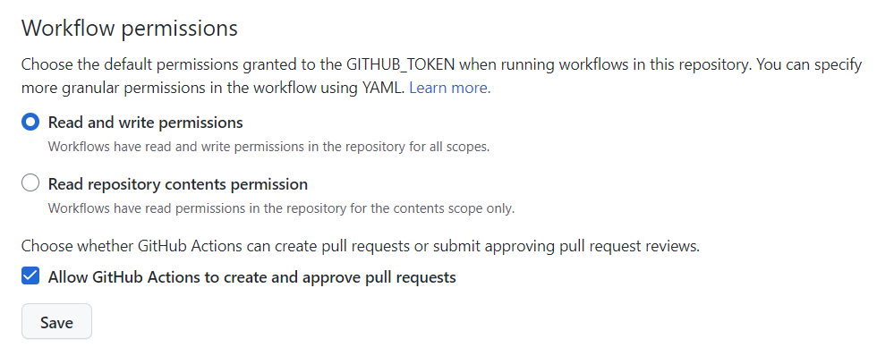
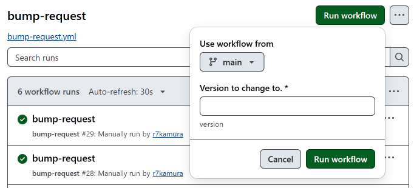
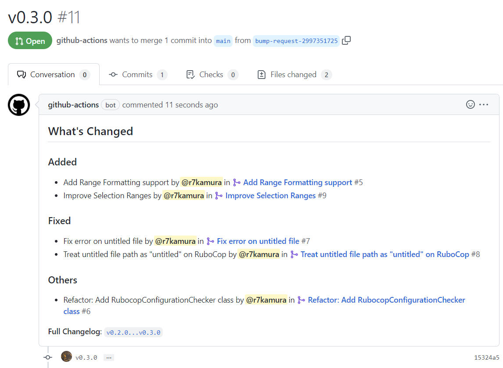

# bump-request

[Custom action](https://docs.github.com/en//actions/creating-actions/about-custom-actions) to create a pull request that bumps version.

## Usage

Create a workflow file as follows:

```yaml
# .github/workflows/bump-request.yml
name: bump-request

on:
  workflow_dispatch:
    inputs:
      version:
        description: Next version (e.g. 1.2.3).
        required: true
        type: string

jobs:
  run:
    runs-on: ubuntu-latest
    steps:
      - uses: r7kamura/bump-request@v0
        with:
          command: echo "$VERSION" > VERSION
          version: ${{ inputs.version }}
```

This action checks out your repository by itself, so you do not need `actions/checkout` before it.

Then allow your repository to create pull requests from GitHub Actions:



Now you can run it manually via actions page:



After the action is complete, a new pull request is created:



This action uses [Automatically generated release notes](https://docs.github.com/en//repositories/releasing-projects-on-github/automatically-generated-release-notes) to generate a pull request description.
If you want to customize the contents, try setting up `.github/release.yml` according to this documentation.

This action simply creates a pull request and does nothing more. If you want to automate package publishing, Git tagging, etc., it is recommended to prepare a separate workflow that detects changes in the file containing the version and does so, using [softprops/action-gh-release](https://github.com/softprops/action-gh-release) or other actions.

## Inputs

### `command`

Required. Shell script to update files that contain the version.

The next version is passed as an environment variable `VERSION`.

For a gem:

```yaml
command: |
  version_file=$(find lib -name version.rb)
  sed -i -E "s/VERSION = (['\"]).*(['\"])/VERSION = '$VERSION'/" "$version_file"
  bundle install
```

For a plain version file:

```yaml
command: echo "$VERSION" > VERSION
```

For a crate:

```yaml
command: sed -i -E "0,/^version = \"[^\"]+\"/s//version = \"$VERSION\"/" Cargo.toml
```

For an npm package:

```yaml
command: npm version "$VERSION" --no-git-tag-version
```

### `version`

Required. The next version to bump to.

- e.g. `1.2.3`

### `github_token`

Optional. GitHub access token. Defaults to `github.token`.

If `command` or `version` is empty, the action fails with an error such as `command input is required.`
